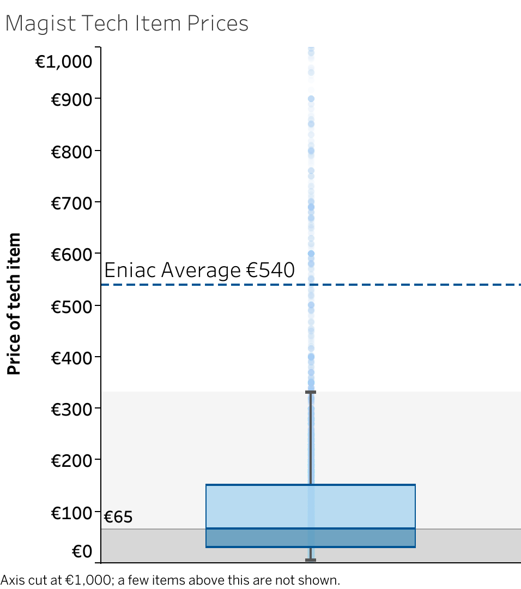
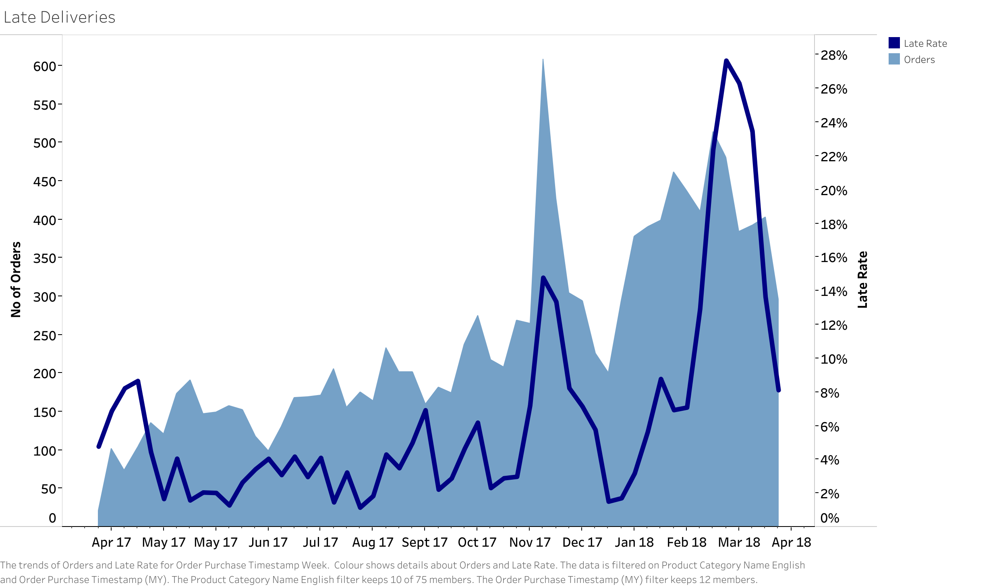
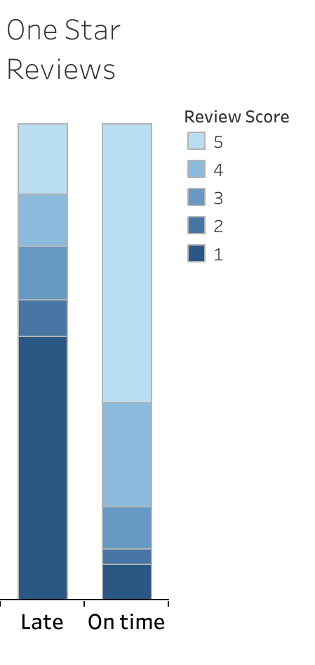

# Should Eniac Enter Brazil Through Magist? A SQL & Tableau Market Analysis

## 🎯 Project Overview

This was a group case study I completed as part of the **WBS Coding School Data Analytics bootcamp**.

**The scenario:** Eniac, a Spanish online store selling Apple products and Apple-compatible accessories, wanted to expand into Brazil. The plan was to sign a 3-year contract with **Magist**, a Brazilian company that helps small sellers list on big marketplaces and handles their delivery.

**The point of the case study:** use Magist's real sales database to answer the business question: *should Eniac sign the deal?* Eniac's management had two worries:

- **Product fit:** Is Magist a good place to sell high-end tech?
- **Delivery speed:** Eniac's customers expect fast delivery. Are Magist's deliveries fast enough?

**Our answer: No. Eniac should not partner with Magist.** Magist's tech buyers mostly buy cheap items, deliveries take two weeks on average, and late deliveries hurt review scores.

**Team Voltage:** Louise Gorman, Jeshwanthi Chitti Babu, and Shardul Vedpathak. I presented the final findings.

**Result:** [final presentation (PDF)](presentation/eniac_magist_presentation.pdf) 


## 📊 Dataset & Sources

- **Source:** Magist MySQL database, provided by WBS Coding School ([database schema](magist_schema.pdf))
- **Tables used:** `orders`, `order_items`, `products`, `product_category_name_translation`, `order_reviews`
- **Time period analysed:** 1 April 2017 to 31 March 2018 (the same 12 months as Eniac's own figures, so we compare like for like)
- **Eniac's figures** (€14M yearly revenue, €1.17M a month, €540 average item price) came from the case brief

**Key decisions and limits:**

- The database has **no product names**, so the team chose 10 categories to count as "tech": `audio`, `cine_photo`, `computers`, `computers_accessories`, `consoles_games`, `electronics`, `pc_gamer`, `tablets_printing_image`, `telephony`, `watches_gifts`
- Cancelled and unavailable orders were left out
- Deliveries and reviews are counted per **order**; prices are counted per **item**
- "On time" means delivered on or before **Magist's own estimated date**

## 🚀 Key Findings

- **Magist is not a high-end tech platform.** The average Magist tech item costs **€130**. Eniac's average item costs **€540**.
- **Eniac would be an exception, not a normal seller.** Eniac's €540 average is higher than **95% of Magist tech items**. Half of all tech items sold cost **€65 or less**.
- **The market is small.** All Magist tech sales combined make about **€153k a month**. Eniac alone makes **€1.17M a month** — about 7 times more.
- **On-time looks good, but only because estimates are generous.** **91%** of tech orders arrive on time — but Magist promises **25 days** on average. Actual delivery takes **14 days**, which is too slow for Eniac.
- **Late deliveries spike at busy times.** **20%** of tech orders were late in March 2018 and **16%** in Black Friday week, compared with **5%** in a normal month.
- **Late orders get bad reviews.** Late orders average **2.2 stars**, on-time orders **4.2 stars**. A late order is **7 times more likely** to get a 1-star review.
- **Trust risk for Apple products.** Some 1-star reviews complain about fake or wrong Apple products, e.g. *"The product photo showed an original, with the Apple logo. What arrived was not original."* (translated from Portuguese)

**Recommendation:** Do not partner with Magist. The risks outweigh the rewards.

## 📈 Visualisations

### What counts as "expensive" on Magist? A box plot of tech item prices




*Each dot is one tech item sold (14,430 items). Half cost €65 or less, and three quarters cost under €150. Anything above €331 is unusually expensive for Magist. Eniac's €540 average is higher than 95% of items.*

### Late deliveries go up when orders go up




*Light blue = number of tech orders per month. Dark blue = % delivered late. 20% were late in March 2018, compared with 5% in a normal month.*

### Late orders get much worse reviews




*Late orders average 2.2 stars, on-time orders 4.2 stars. 56% of late orders get a 1-star review, compared with 7.5% of on-time orders.*

👉 **Interactive charts on Tableau Public:** [https://public.tableau.com/app/profile/louise.gorman/vizzes](https://public.tableau.com/app/profile/louise.gorman/vizzes)

## 🛠️ Technologies Used

- **SQL:** MySQL, MySQL Workbench
- **Visualisation:** Tableau
- **Presentation:** Google Slides

## 📁 Project Structure

```
├── README.md
├── presentation/
│   └── eniac_magist_presentation.pdf   # Final slides
├── sql/
│   └── eniac_magist_queries.sql        # Every query behind every figure in the slides
├── tableau/
│   ├── *.csv                           # Magist tables exported from MySQL and loaded into Tableau
│   └── eniac_magist.twbx               # Tableau workbook with all charts
├── images/
│   └── *.png                           # Charts shown in this README
└── magist_schema.pdf                   # Database diagram
```

## 🔗 How to Use This Project

1. **Quick look:** read the [final presentation (PDF)](presentation/eniac_magist_presentation.pdf) — it is the 5-minute summary.
2. **Check the numbers:** open [`sql/eniac_magist_queries.sql`](sql/). The queries are grouped by topic (revenue, prices, box plot, deliveries, reviews). Each one has a comment showing the result it returns.
3. **Run the queries yourself:** you need the Magist database loaded into MySQL. Run the file top to bottom in MySQL Workbench.
4. **See the charts:** open the Tableau Public link above, or load the CSVs in `tableau/` into Tableau.

## 📬 Contact

- **LinkedIn:** [https://linkedin.com/in/louise-gorman](https://linkedin.com/in/louise-gorman)
- **GitHub:** [https://github.com/louisegorman](https://github.com/louisegorman)
